# 银联商务 RAG/KMS 项目全量分析说明书

> 生成日期：2026-10-20
> 范围：**项目主体代码**——`app/`、`kms/`、`gateway/`、`scripts/`、`examples/` 与根入口；**不含 `tests/` 测试代码**（本次按要求不分析测试）；另排除 `venv/`、`data/` 下的历史语料与缓存产物、`__pycache__`、`.git`、`node_modules`。
> 性质：**基于代码事实的静态分析报告**，所有数字均来自对源码的实际统计。

---

## 0. 统计口径（务必先读）

本报告中所有计数遵循以下口径，避免"数字对不上"：

| 指标 | 口径 | 工具/方法 |
|---|---|---|
| 文件数 | 仅统计版本库内受控文件；不含 `venv/`、`__pycache__`、`data/` 下运行时产物 | `Get-ChildItem -Recurse -Include` |
| 函数数 | 源码中 `def` / `async def` 开头行（**包含类方法、嵌套函数、`__init__`**）；不含 docstring 内文本 | `Select-String '^\s*(async\s+def\|def)\s+\w+'` |
| 类数 | 源码中 `class` 开头行（含嵌套类、`Enum`） | `Select-String '^\s*class\s+\w+'` |
| 表数 | 全部 `CREATE TABLE` 语句（含 `IF NOT EXISTS`）；另计 `ALTER TABLE ... ADD COLUMN` 造成的结构扩展 | `Select-String 'CREATE TABLE'` + `ALTER TABLE` |

**重要提示**：`def` 计数会把类方法、内部闭包、以及部分以 `def` 开头的文档字符串一并计入，因此**函数总数是一个"代码单元"上界值**，用于衡量规模而非精确的"可调用 API 个数"。若只统计 HTTP 端点（FastAPI 路由函数），数量远小于此，见第 6 节标注。

---

## 1. 项目总览

本项目是**单仓库双服务**的企业级 RAG 问答 + 知识文档管理系统，服务于两个互相隔离的目标：

| 服务 | 入口 | 端口 | 定位 | 数据边界 |
|---|---|---|---|---|
| **QA 问答服务** | `api.py` → `app/main.py` | **6341（固定）** | 竞赛评测 `/chat` 接口，无员工认证 | 仅装载竞赛公开语料 |
| **KMS 知识管理系统** | `run_kms.py` → `scripts/service.py kms` | **6342~6350（默认 6342）** | 企业知识管理：权限、工单、审批、API 网关、多渠道接入 | 企业数据，含 BLP 密级体系 |

两服务**强制数据隔离**：不同 MySQL 数据库（由各自 `.env` / `.env.kms` 的 `MYSQL_DATABASE` 决定）、不同 FAISS 索引、不同上传/文档目录，启动器 `scripts/service.py` 会做部署值校验，端口冲突即退出，不自动换端口。

**技术栈**：
- 语言/框架：Python 3.11 + FastAPI + uvicorn；前端为原生 ES Module JS（无框架、无构建步骤）
- 存储：MySQL（业务数据，`pymysql` + `dbutils` 连接池）、FAISS（向量索引，`IndexIDMap2` 包装 `IndexFlatIP`）、SQLite（网关单机状态）
- 模型：Embedding（`bge-m3`）、Reranker（`bge-reranker-v2-m3`）、LLM（`DeepSeek-V4-Flash`）、OCR（`PaddleOCR-VL-1.5`），全部经 OpenAI 兼容 HTTP 接口调用（见 `app/clients.py`）
- 认证/加密：零新增依赖——PBKDF2 密码散列 + stdlib 实现的 HS256 JWT；飞书 AES 解密 + SHA256 签名校验均为标准库自研
- 依赖清单：[requirements.txt](file:///d:/Desktop/银联商务code/rag_project_local/requirements.txt)

**规模速览**：

| 项目 | 数值 |
|---|---|
| 项目主体 Python 文件 | **82** 个（app 9 + kms 18 + gateway 23 + scripts 28 + examples 1 + 根入口 3） |
| **函数/代码单元总数（项目主体）** | **764** |
| 类总数（项目主体） | **58** |
| 数据库表总数 | **27 种表名 / 30 个物理实例**（见第 7 节） |
| 前端 JS 函数声明（`kms/web/app.js`） | 175 |
| 设计文档（`docs/*.md`） | **13** 篇 |

---

## 2. 目录结构与职责分层

```
rag_project_local/
├── api.py                     # QA 服务：FastAPI 路由（/chat、/health）
├── config.py                  # 全局唯一配置源（Settings 单例 + validate_ports）
├── run_kms.py                 # KMS 服务：应用装配（create_app）+ FAISS Unicode 补丁
├── app/                       # RAG 内核（QA 与 KMS 共用）
│   ├── api.py                 #   /chat 路由（app 包内副本，与根 api.py 同构）
│   ├── main.py                #   QA 服务 create_app / lifespan
│   ├── clients.py             #   模型客户端（Embedding/LLM/Reranker/OCR）
│   ├── document.py            #   文档加载 + OCR 编排 + 结构化解析 + 分块
│   ├── rag.py                 #   检索/重排/两段式生成/父块扩展核心
│   ├── store.py               #   MySQL / FAISS / BM25 三种存储
│   ├── typo_clean.py          #   OCR 形近错字清洗
│   └── logger.py              #   结构化日志
├── kms/                       # KMS 业务域（权限、生命周期、组织、推荐、SSO）
│   ├── security.py            #   JWT/密码/身份依赖（AuthUser、require_*）
│   ├── access_control.py      #   BLP 判定 + 用户/工单/审计/通知 CRUD（核心）
│   ├── constants.py           #   全局常量（密级、工单模块、HR 维度）
│   ├── lifecycle.py           #   文档生命周期状态机
│   ├── org.py                 #   组织树（org_path 前缀继承）
│   ├── hr_sync.py             #   HR 主数据单向只读同步
│   ├── directory.py           #   目录源适配器（seed/ldap/ad/hr_api）
│   ├── oidc.py / oidc_provider.py  #   SSO 模拟流 + 外部 OIDC 校验
│   ├── apps.py                #   第三方应用 API Key 管理
│   ├── ratelimit.py           #   跨实例限流 + 指标计数
│   ├── recommend.py           #   四路融合定向推荐
│   ├── versioning.py          #   文档版本管理
│   ├── admin_routes.py        #   /kms/api/auth/* + /admin/*
│   ├── pagination.py          #   分页参数规范化
│   ├── formats.py             #   文件类型白名单与搜集
│   ├── routes.py              #   单例（get_retriever/get_indexer）与热更新
│   └── web/                   #   前端工作台（见第 5 节）
├── gateway/                   # 对外 API 网关 + KMS 受控业务路由
│   ├── __init__.py            #   openapi_router 装配 + ensure_gateway_tables
│   ├── routes_kms.py          #   /kms/api/* 文档/问答/治理/应用（最大路由文件）
│   ├── routes_tickets.py      #   /kms/api/tickets/* 两段式工单 + 回收站
│   ├── routes_upload.py       #   /kms/api/documents/batch-upload 批次上传
│   ├── routes_knowledge.py    #   /kms/api/knowledge/* 统计
│   ├── routes_embed.py        #   /gw/api/v1/embed/* 嵌入式接口
│   ├── routes_bots.py         #   /gw/api/v1/bots/feishu|wecom 机器人
│   ├── service.py             #   授权过滤 + 企业问答（answer/answer_stream）
│   ├── middleware.py          #   EnterpriseBoundary 安全边界中间件
│   ├── state.py               #   SQLite 单机状态（任务/回执/会话/撤销）
│   ├── audit.py               #   网关审计（MySQL + JSONL 双写）
│   ├── identity.py            #   机器人外部身份 ↔ 员工工号绑定
│   ├── crypto.py              #   飞书/企微消息加解密与签名
│   ├── clients.py             #   飞书/企微 HTTP 客户端
│   ├── logctx.py              #   请求 ID 注入日志
│   └── mcp/                   #   MCP 知识服务面（默认关闭）
├── scripts/                   # 受控启动、入库、运维、校验（28 个脚本）
├── tests/                     # 离线安全回归（本次分析不含测试代码）
├── examples/embed_bff.py      # 嵌入式问答 BFF 同源示例
├── docs/                      # 设计与交付文档（13 篇）
└── frontend/                  # 早期 Vue/Vite 实验目录（非当前交付路径）
```

---

## 3. 文件清单与功能（逐文件）

### 3.1 根目录

| 文件 | 行数 | 功能 |
|---|---|---|
| [api.py](file:///d:/Desktop/银联商务code/rag_project_local/api.py) | 98 | QA 服务赛题路由：`/chat`（兼容 JSON/form/query 三种入参）+ `/health` |
| [config.py](file:///d:/Desktop/银联商务code/rag_project_local/config.py) | 208 | 全局唯一配置源。`Settings` 类集中读取 `.env`；`validate_ports()` 强校验端口/CORS/目录源/OIDC/推荐权重等，任何违规直接抛错拒绝启动 |
| [run_kms.py](file:///d:/Desktop/银联商务code/rag_project_local/run_kms.py) | 279 | KMS 服务装配。FAISS Unicode 路径补丁、`lifespan` 预热与建表、路由挂载、前端 no-cache 中间件 |
| [AGENTS.md](file:///d:/Desktop/银联商务code/rag_project_local/AGENTS.md) | 76 | 代理路由指南：模块边界、变更风险、禁止事项 |
| [requirements.txt](file:///d:/Desktop/银联商务code/rag_project_local/requirements.txt) | 21 | 依赖清单（`>=` 范围约束） |
| [DEPLOY.md](file:///d:/Desktop/银联商务code/rag_project_local/DEPLOY.md) / [HOST_DEPLOY_CHECKLIST.md](file:///d:/Desktop/银联商务code/rag_project_local/HOST_DEPLOY_CHECKLIST.md) | 157 / 145 | Linux 迁移与部署核对清单 |
| [.env](file:///d:/Desktop/银联商务code/rag_project_local/.env) / [.env.kms](file:///d:/Desktop/银联商务code/rag_project_local/.env.kms) | 46 / 80 | QA / KMS 两套环境变量（隔离数据库与端口） |
| [start_local.bat](file:///d:/Desktop/银联商务code/rag_project_local/start_local.bat) / [start.sh](file:///d:/Desktop/银联商务code/rag_project_local/start.sh) / [stop.sh](file:///d:/Desktop/银联商务code/rag_project_local/stop.sh) | 12 / 6 / 11 | 跨平台启停入口 |
| [kms.service](file:///d:/Desktop/银联商务code/rag_project_local/kms.service) / [rag.service](file:///d:/Desktop/银联商务code/rag_project_local/rag.service) | 21 / 21 | systemd 服务单元 |
| `_e2e.py` / `_test_full.py` / `_test_batch.py` | 410 / 209 / 35 | 根目录测试/探针脚本，**非项目主体**（本次不分析） |

### 3.2 `app/` — RAG 内核（7 模块 + 包初始化）

| 文件 | 行数 | 函数 | 功能 |
|---|---|---|---|
| [app/document.py](file:///d:/Desktop/银联商务code/rag_project_local/app/document.py) | 1473 | **60** | 文档解析主引擎：PDF/DOCX/XLSX/MD/TXT 加载、**逐页自适应 OCR 判定**、表格→Markdown、文本行去重/循环清理、`Chunker` 分块 |
| [app/rag.py](file:///d:/Desktop/银联商务code/rag_project_local/app/rag.py) | 1445 | **44** | 检索与生成核心：`Indexer`（入库）、`Retriever`（混合检索 + RRF 融合 + 重排 + 两段式生成）、父块扩展、证据抽取、拒答判定 |
| [app/store.py](file:///d:/Desktop/银联商务code/rag_project_local/app/store.py) | 418 | 33 | 三套存储：`MySQLStore`（DDL/连接池/事务）、`VectorStore`（FAISS）、`BM25Store`（jieba 分词倒排） |
| [app/clients.py](file:///d:/Desktop/银联商务code/rag_project_local/app/clients.py) | 376 | 22 | 模型客户端：`EmbeddingClient`（含 LRU 缓存）、`LLMClient`（chat/stream）、`RerankerClient`、`OCRClient` |
| [app/typo_clean.py](file:///d:/Desktop/银联商务code/rag_project_local/app/typo_clean.py) | 115 | 1 | OCR 形近错字清洗（数字保护式替换） |
| [app/main.py](file:///d:/Desktop/银联商务code/rag_project_local/app/main.py) | 104 | 3 | QA 服务 `create_app` / `lifespan` / `readiness` |
| [app/api.py](file:///d:/Desktop/银联商务code/rag_project_local/app/api.py) | 97 | 4 | `/chat`、`/health` 路由（与根 `api.py` 同构副本） |
| [app/logger.py](file:///d:/Desktop/银联商务code/rag_project_local/app/logger.py) | 29 | 1 | `get_logger` 统一日志工厂 |
| `app/__init__.py` | 10 | 0 | 包导出 |

### 3.3 `kms/` — 权限与业务域

| 文件 | 行数 | 函数 | 功能 |
|---|---|---|---|
| [kms/access_control.py](file:///d:/Desktop/银联商务code/rag_project_local/kms/access_control.py) | 751 | **34** | **权限与数据核心**：`ensure_kms_acl_tables` 建表+迁移、BLP 读写判定、审批人自动匹配、用户 CRUD、审计/通知读写、会话归属 |
| [kms/security.py](file:///d:/Desktop/银联商务code/rag_project_local/kms/security.py) | 529 | **31** | 认证鉴权：PBKDF2、HS256 JWT 签发/校验、`AuthUser`、登录限速、`require_user/auditor/level`、HR 涉密资格判定 `hr_secret_eligible` |
| [kms/admin_routes.py](file:///d:/Desktop/银联商务code/rag_project_local/kms/admin_routes.py) | 493 | 17 | `/kms/api/auth/*` 与 `/admin/*`：登录、改密、用户/层级/部门、审计查询、HR 同步触发 |
| [kms/hr_sync.py](file:///d:/Desktop/银联商务code/rag_project_local/kms/hr_sync.py) | 373 | 10 | HR 主数据单向同步（upsert）、CSV/HTTP 源解析、同步历史 |
| [kms/oidc.py](file:///d:/Desktop/银联商务code/rag_project_local/kms/oidc.py) | 362 | 12 | SSO OIDC 模拟流：authorize → 登录页 → 授权码（60s）→ token → 会话 |
| [kms/recommend.py](file:///d:/Desktop/银联商务code/rag_project_local/kms/recommend.py) | 333 | 17 | 组织画像/语义/协同/热度四路加权推荐，候选逐条过权限硬过滤 |
| [kms/constants.py](file:///d:/Desktop/银联商务code/rag_project_local/kms/constants.py) | 325 | 0 | 全局常量：文档密级名、工单模块/状态/超时、HR 维度白名单 |
| [kms/org.py](file:///d:/Desktop/银联商务code/rag_project_local/kms/org.py) | 316 | 11 | 组织树：建表、`org_path` 计算、种子/LDAP 同步、用户组织回填 |
| [kms/directory.py](file:///d:/Desktop/银联商务code/rag_project_local/kms/directory.py) | 303 | 24 | 可插拔目录适配器：`Seed/LDAP/AD/HR API` 四种实现 + 工厂 |
| [kms/lifecycle.py](file:///d:/Desktop/银联商务code/rag_project_local/kms/lifecycle.py) | 300 | 13 | 文档生命周期状态机：draft/published/archived/expired，状态转换校验 |
| [kms/ratelimit.py](file:///d:/Desktop/银联商务code/rag_project_local/kms/ratelimit.py) | 275 | 14 | 跨实例固定窗口限流 + 指标计数（MySQL 持久化） |
| [kms/versioning.py](file:///d:/Desktop/银联商务code/rag_project_local/kms/versioning.py) | 219 | 7 | 文档版本：记录版本、列表、回滚（旧源文件重 ingest） |
| [kms/apps.py](file:///d:/Desktop/银联商务code/rag_project_local/kms/apps.py) | 182 | 14 | 第三方应用 API Key：SHA-256 存哈希、密级上下界、轮换、鉴权 |
| [kms/oidc_provider.py](file:///d:/Desktop/银联商务code/rag_project_local/kms/oidc_provider.py) | 89 | 4 | 统一登录抽象：builtin 模拟 / external 外部 OIDC（JWKS + RS256） |
| [kms/__init__.py](file:///d:/Desktop/银联商务code/rag_project_local/kms/__init__.py) | 51 | 0 | 包初始化 |
| [kms/routes.py](file:///d:/Desktop/银联商务code/rag_project_local/kms/routes.py) | 50 | 4 | 单例与热更新：`get_indexer/get_retriever/get_vector_store/_hot_update_caches` |
| [kms/pagination.py](file:///d:/Desktop/银联商务code/rag_project_local/kms/pagination.py) | 46 | 4 | 分页参数规范化（clamp） |
| [kms/formats.py](file:///d:/Desktop/银联商务code/rag_project_local/kms/formats.py) | 45 | 3 | 文件类型白名单与目录搜集 |

### 3.4 `gateway/` — 对外网关与受控业务路由

| 文件 | 行数 | 函数 | 功能 |
|---|---|---|---|
| [gateway/routes_tickets.py](file:///d:/Desktop/银联商务code/rag_project_local/gateway/routes_tickets.py) | 1091 | **47** | **工单中心**：两段式（申请→审批即执行）、执行器（删除/恢复/上传/更新）、回收站与宽限期清扫、文档快照、通知 |
| [gateway/routes_kms.py](file:///d:/Desktop/银联商务code/rag_project_local/gateway/routes_kms.py) | 846 | **39** | 文档/问答/治理/应用路由：列表、详情、下载、上传、问答（含 SSE）、治理申请与决策、应用管理 |
| [gateway/routes_upload.py](file:///d:/Desktop/银联商务code/rag_project_local/gateway/routes_upload.py) | 363 | 10 | 批量上传：批次建单 + 线程池后台摄入 + 轮询状态 |
| [gateway/service.py](file:///d:/Desktop/银联商务code/rag_project_local/gateway/service.py) | 264 | 8 | 企业问答安全边界：`migrate()` 列迁移、`allowed()` 授权判定、`answer/answer_stream` |
| [gateway/mcp/tools.py](file:///d:/Desktop/银联商务code/rag_project_local/gateway/mcp/tools.py) | 210 | 11 | MCP 工具实现（8 个白名单工具） |
| [gateway/routes_bots.py](file:///d:/Desktop/银联商务code/rag_project_local/gateway/routes_bots.py) | 172 | 12 | 飞书/企微回调：验签→解密→身份映射→异步入队→回复 |
| [gateway/state.py](file:///d:/Desktop/银联商务code/rag_project_local/gateway/state.py) | 170 | 15 | SQLite 单机状态：任务队列、回执、令牌撤销、会话 |
| [gateway/crypto.py](file:///d:/Desktop/银联商务code/rag_project_local/gateway/crypto.py) | 166 | 13 | 飞书 AES 解密/签名、企微消息加解密与 PKCS7 |
| [gateway/mcp/protocol.py](file:///d:/Desktop/银联商务code/rag_project_local/gateway/mcp/protocol.py) | 161 | 15 | MCP JSON-RPC 协议：版本协商、结果/错误构造、参数校验 |
| [gateway/clients.py](file:///d:/Desktop/银联商务code/rag_project_local/gateway/clients.py) | 151 | 13 | 飞书/企微 HTTP 客户端（取 token、发文本） |
| [gateway/routes_knowledge.py](file:///d:/Desktop/银联商务code/rag_project_local/gateway/routes_knowledge.py) | 146 | 4 | 知识中心统计：热门文档、趋势、个人统计 |
| [gateway/mcp/schemas.py](file:///d:/Desktop/银联商务code/rag_project_local/gateway/mcp/schemas.py) | 144 | 2 | MCP 工具 JSON-Schema 定义 |
| [gateway/mcp/server.py](file:///d:/Desktop/银联商务code/rag_project_local/gateway/mcp/server.py) | 138 | 6 | MCP 处理入口：分发、审计、指标 |
| [gateway/middleware.py](file:///d:/Desktop/银联商务code/rag_project_local/gateway/middleware.py) | 123 | 3 | `EnterpriseBoundary` 中间件：体量上限、请求 ID、错误信封 |
| [gateway/audit.py](file:///d:/Desktop/银联商务code/rag_project_local/gateway/audit.py) | 114 | 3 | 网关审计：MySQL 表 + JSONL 双写 |
| [gateway/routes_embed.py](file:///d:/Desktop/银联商务code/rag_project_local/gateway/routes_embed.py) | 108 | 10 | 嵌入接口：health/config/chat/documents/feedback（X-API-Key） |
| [gateway/identity.py](file:///d:/Desktop/银联商务code/rag_project_local/gateway/identity.py) | 78 | 5 | 机器人身份绑定：bind/unbind/lookup/resolve |
| [gateway/mcp/auth.py](file:///d:/Desktop/银联商务code/rag_project_local/gateway/mcp/auth.py) | 77 | 9 | MCP 主体认证：API Key / 员工 JWT 双模 |
| [gateway/mcp/guard.py](file:///d:/Desktop/银联商务code/rag_project_local/gateway/mcp/guard.py) | 62 | 5 | 注入防护：不可信内容包装与清洗 |
| [gateway/__init__.py](file:///d:/Desktop/银联商务code/rag_project_local/gateway/__init__.py) | 42 | 1 | `openapi_router` 装配 + `ensure_gateway_tables` |
| [gateway/logctx.py](file:///d:/Desktop/银联商务code/rag_project_local/gateway/logctx.py) | 38 | 3 | 请求 ID 注入日志 filter |
| [gateway/mcp/resources.py](file:///d:/Desktop/银联商务code/rag_project_local/gateway/mcp/resources.py) | 34 | 3 | MCP 资源读取/列表 |
| [gateway/mcp/__init__.py](file:///d:/Desktop/银联商务code/rag_project_local/gateway/mcp/__init__.py) | 26 | 1 | `build_mcp_router`（默认不注册） |

### 3.5 `scripts/` — 受控启动与运维（28 个脚本，共 117 个函数）

| 文件 | 行数 | 函数 | 功能 |
|---|---|---|---|
| [scripts/service.py](file:///d:/Desktop/银联商务code/rag_project_local/scripts/service.py) | 167 | 7 | **唯一受控启动器**：读部署值、环境注入、端口绑定、目录隔离校验 |
| [scripts/init_classify.py](file:///d:/Desktop/银联商务code/rag_project_local/scripts/init_classify.py) | 489 | 14 | 存量文档密级/归属分类初始化（survey→plan→apply） |
| [scripts/init_org.py](file:///d:/Desktop/银联商务code/rag_project_local/scripts/init_org.py) | 268 | 8 | 组织树初始化与可见性校验 |
| [scripts/verify_live.py](file:///d:/Desktop/银联商务code/rag_project_local/scripts/verify_live.py) | 480 | 13 | 在线实机核验：ACL/工单/知识/上传/入库 |
| [scripts/seed_employees.py](file:///d:/Desktop/银联商务code/rag_project_local/scripts/seed_employees.py) | 157 | 4 | 演示员工播种（工号 20260000~20260031，仅本机隔离环境） |
| [scripts/reingest_all.py](file:///d:/Desktop/银联商务code/rag_project_local/scripts/reingest_all.py) | 156 | 3 | 全量重入库（含实例锁，防并发重入） |
| [scripts/maintain_hygiene.py](file:///d:/Desktop/银联商务code/rag_project_local/scripts/maintain_hygiene.py) | 149 | 5 | 数据卫生清理（垃圾块删除） |
| [scripts/eval_accuracy.py](file:///d:/Desktop/银联商务code/rag_project_local/scripts/eval_accuracy.py) | 142 | 8 | 评测集准确率评估 |
| `scripts/repair_table_flatten.py` | 190 | 7 | 表格 OCR 崩坏修复 |
| `scripts/repair_inner_dup.py` | 133 | 5 | chunk 内部重复修复 |
| `scripts/trace_retrieval.py` | 129 | 4 | 检索链路追踪 |
| `scripts/mock_hr_service.py` | 126 | 6 | HR 模拟服务（供同步联调） |
| `scripts/analyze_failures.py` | 135 | 5 | 失败题分析 |
| `scripts/apply_typo_clean.py` | 114 | 3 | 错字清洗批量应用 |
| `scripts/seed_kms_demo.py` | 112 | 3 | KMS 演示数据播种 |
| `scripts/db_hygiene_scan.py` | 102 | 4 | 数据库卫生扫描 |
| `scripts/rollback_org_init.py` | 103 | 3 | 组织初始化回滚 |
| `scripts/reingest_audit.py` | 99 | 3 | 重入库审核 |
| `scripts/ingest_batch.py` | 90 | 2 | 批量入库 |
| `scripts/manage.py` | 83 | 2 | 进程管理 |
| `scripts/verify_reingest.py` | 69 | 0 | 重入库核验 |
| `scripts/bootstrap_employee.py` | 63 | 1 | 员工引导创建 |
| `scripts/backup_db.py` / `restore_db.py` | 58 / 53 | 1 / 1 | 数据库备份/恢复 |
| `scripts/package_release.py` | 46 | 2 | 发布包打包（白名单） |
| `scripts/ingest.py` / `query.py` | 36 / 24 | 2 / 1 | 单文件入库 / 单次查询 |
| `scripts/check_port.sh` / `qa_curl_eval.sh` | 26 / 165 | — | 端口检查 / 评测 curl 脚本 |

---

## 4. 模块引用关系（文件与文件之间）

### 4.1 依赖分层（自顶向下，箭头 = import）

```mermaid
graph TD
    subgraph 入口层
        QAapi[api.py / app/api.py]
        QAmain[app/main.py]
        RUNKMS[run_kms.py]
        SVC[scripts/service.py]
    end
    subgraph 网关层
        GWinit[gateway/__init__.py]
        GWkms[gateway/routes_kms.py]
        GWtick[gateway/routes_tickets.py]
        GWup[gateway/routes_upload.py]
        GWsvc[gateway/service.py]
        GWbots[gateway/routes_bots.py]
        GWemb[gateway/routes_embed.py]
        GWkn[gateway/routes_knowledge.py]
        GWmid[gateway/middleware.py]
        GWst[gateway/state.py]
        GWaud[gateway/audit.py]
        GWid[gateway/identity.py]
        GWMCP[gateway/mcp/*]
    end
    subgraph KMS域
        KSEC[kms/security.py]
        KACL[kms/access_control.py]
        KLIFE[kms/lifecycle.py]
        KORG[kms/org.py]
        KHR[kms/hr_sync.py]
        KDIR[kms/directory.py]
        KAPP[kms/apps.py]
        KREC[kms/recommend.py]
        KRATE[kms/ratelimit.py]
        KVER[kms/versioning.py]
        KOIDC[kms/oidc.py]
        KADM[kms/admin_routes.py]
        KROUTE[kms/routes.py]
        KCONST[kms/constants.py]
    end
    subgraph RAG内核
        ARAG[app/rag.py]
        ADOC[app/document.py]
        ASTORE[app/store.py]
        ACLI[app/clients.py]
    end
    CFG[config.py]
    SQLLite[(SQLite state)]
    MY[(MySQL)]

    RUNKMS --> KROUTE
    RUNKMS --> GWkms & GWtick & GWkn & GWup & KADM & KOIDC & GWinit & GWmid
    QAmain --> QAapi
    QAapi --> ARAG
    SVC --> CFG

    GWkms --> KACL & KSEC & KVER & KREC & GWup & KROUTE
    GWtick --> KACL & KLIFE & KSEC & KROUTE
    GWup --> GWkms & KVER & KROUTE
    GWsvc --> KACL & KORG & KROUTE & ARAG
    GWbots --> GWaud & GWid & GWsvc & GWst
    GWemb --> KACL & KAPP & KRATE & KSEC
    GWmid --> KSEC & KRATE
    GWMCP --> KAPP & KSEC & KRATE & KREC & KROUTE & GWsvc & GWst
    KADM --> GWst & KROUTE
    KSEC --> GWst
    KSEC --> MY
    KACL --> MY
    KHR & KLIFE & KORG & KAPP & KREC & KRATE & KVER --> MY
    KREC --> GWsvc & KSEC & KROUTE
    KVER --> KROUTE & GWtick
    KROUTE --> ARAG
    ARAG --> ADOC & ASTORE & ACLI
    ADOC --> ACLI
    GWst --> SQLLite
    CFG --> MY
```



### 4.2 关键 import 边（实测，非推断）

**内核对（无外部业务依赖，可被两服务共用）**
- `app/rag.py` ← `app/{clients,document,logger,store,typo_clean}` + `config`
- `app/document.py` ← `app/{logger,clients}` + `config`
- `app/store.py` ← `config` + `app/logger`
- `kms/routes.py` ← `app/{rag,store}` + `config`（**KMS 侧唯一的 RAG 接入点**）

**KMS 域**
- `kms/access_control.py` ← `app/{logger,store}`（不依赖 security，避免循环）
- `kms/security.py` ← `config` + `gateway/state`（`token_allowed/validate_session`）+ `app/store`
- `kms/admin_routes.py` ← `gateway/state` + `app/store` + `config` + `kms/routes`
- `kms/recommend.py` ← `gateway/{service,audit}` + `kms/security` + `kms/routes`
- `kms/versioning.py` ← `kms/routes` + `gateway/routes_tickets`（`_post_commit_cleanup_faiss`）
- `kms/oidc.py` / `kms/oidc_provider.py` / `kms/directory.py` ← `config`（适配器工厂）
- `kms/hr_sync.py` / `kms/lifecycle.py` / `kms/org.py` / `kms/apps.py` / `kms/ratelimit.py` ← `app/store`

**网关层**
- `gateway/routes_kms.py` ← `kms/{access_control,constants,formats,security,recommend,versioning,apps,routes}` + `gateway/routes_upload`
- `gateway/routes_tickets.py` ← `kms/{access_control,constants,lifecycle,security,routes}`
- `gateway/routes_upload.py` ← `gateway/routes_kms` + `kms/{constants,formats,security,versioning,routes}` + `gateway/routes_tickets`
- `gateway/service.py` ← `kms/{access_control,constants,security,org,routes}` + `app/rag`
- `gateway/state.py` ← `config`（**唯一使用 SQLite 的模块**）
- `gateway/audit.py` / `gateway/identity.py` ← `app/store` + `config`

### 4.3 循环依赖风险与现有规避

代码中已可见**多处刻意的规避注释**，说明这是一条被主动管理的约束：

1. `kms/routes.py` 与 `gateway/*` 之间：`routes_tickets.py` 用**函数内局部 import**（`from kms import access_control as _acl  # 本地导入避免循环`）而非模块顶层导入，打断 `routes_tickets ↔ access_control` 的环。
2. `kms/recommend.py → gateway/service.py → kms/routes.py → app/rag.py`：方向单向，不回流 kms/recommend。
3. `kms/security.py → gateway/state.py`：`state.py` 只依赖 `config`，是叶子节点，不成环。
4. `kms/routes.py` 保留 17 个旧端点源码但 `router` **从不被 `run_kms.py` include**，属刻意隔离的死代码（文件头有明确说明）。

**结论**：当前 import 图是一张有向无环图（DAG），核心内核对业务域零反向依赖。

---

## 5. 前端文件关系（`kms/web/`）

交付路径是原生 ES Module，**无打包、无框架**。`kms/web/dist/` 是历史构建产物，非当前加载路径。

```
kms/web/
├── index.html               # 单页工作台（508 行）
├── app.js                   # 主逻辑巨型脚本（2654 行，175 个函数声明），经典 script 加载
├── style.css                # 全站样式（1797 行）
├── knowledge-widget.js      # Web Component：<enterprise-knowledge>（可嵌入式问答组件，180 行）
├── js/
│   ├── app.js               # ES Module 入口（48 行）
│   ├── core/
│   │   ├── dom.js           # DOM 辅助
│   │   ├── http.js          # fetch 封装（89 行）
│   │   └── policy.js        # 前端密级/写权限策略镜像（101 行）
│   ├── sdk/kms-client.js    # KMS API SDK（159 行）
│   └── ui/
│       ├── md.js            # Markdown 渲染
│       └── ui-kit.js        # UI 组件集（111 行，6 个函数）
└── dist/                    # 旧构建产物（knowledge-list.js 4520 行）
```

**关系要点**：
- `index.html` 同时加载经典脚本 `app.js` **和** ES Module 入口 `js/app.js`，两者共用后端接口。
- `js/sdk/kms-client.js` 是前端唯一的后端调用封装层——所有后端请求须在此 SDK 中有对应方法（历史上清理过 3 处悬空调用）。
- `js/core/policy.js` 是后端 BLP 规则的**前端只读镜像**，仅用于 UI 显隐，不参与安全判定（服务端仍是权威）。

---

## 6. 函数清单（按模块）

> 说明：下表给出每个文件的**函数名全量列表**；对核心业务函数补充"作用"。`__init__` 因在多个类中重复出现，列表中会多次出现属正常。

### 6.1 `app/` — RAG 内核（168 个）

**app/clients.py（22）** — 模型客户端
`__init__`（各客户端）/ `client` / `close` / `_post` / `chat` / `chat_with_prompt` / `chat_stream` / `_emb_cache_key` / `_emb_cache_get` / `_emb_cache_put` / `_clean_text` / `embed` / `_embed_batch` / `embed_one` / `rerank` / `_cache_get` / `_cache_put` / `ocr`
- `embed`/`embed_one`：文本向量化；`_clean_text`：去噪后送模型；`rerank`：候选重排；`chat`/`chat_stream`：LLM 生成；`ocr`：OCR 模型调用

**app/document.py（60）** — 文档解析与分块
- OCR 编排：`_ocr_line_quality_ok` / `_ocr_vs_pdfplumber_similar` / `_ocr_degenerate` / `_ocr_page_decomposed` / `_page_ocr_with_upgrade` / `_ocr_strip_attempt` / `_ocr_strip_with_retry` / `ocr` / `_ocr_docx_image`
- 版面/文本清理：`_norm_compact` / `_char_bigrams` / `_extract_page_text_colwise` / `_clean_layout_tokens` / `_scan_bands` / `_detect_horizontal_line_count` / `_merge_runs` / `_merge_text_and_ocr` / `_postprocess_ocr_text` / `_dedup_consecutive_lines` / `_is_cyclic_line` / `_drop_cyclic_lines` / `_truncate_inline_cycle` / `_clean_degenerate_text` / `_unwrap_stuffed_para` / `_collapse_inline_repeat` / `_collapse_inline_partial` / `_compress_repeated_text` / `_strip_prompt_echo` / `_strip_ocr_echo` / `_normalize_docx_para` / `_normalize_docx_cell`
- 结构化：`_rows_to_markdown` / `_table_to_markdown` / `_extract_title_from_filename` / `_default_meta` / `_lookup_meta` / `_load_pdf_structured` / `_load_docx_structured` / `_load_doc_structured` / `_load_xlsx_structured` / `_load_md_structured` / `_load_text_structured` / `load_structured`
- 按类型加载：`_load_pdf` / `_load_docx` / `_load_doc` / `_doc_via_subprocess` / `_doc_via_libreoffice` / `_doc_extract_pure` / `_load_xlsx` / `_load_md` / `_load_text` / `load`
- 分块：`Chunker.split` / `split_with_positions` / `_recursive_split` / `_hard_split` / `_merge_with_overlap` / `_char_bigrams`

**app/rag.py（44）** — 检索与生成
- `Indexer`：`__init__` / `ingest`
- `ChunkCache`：`__init__` / `load` / `get_parent_window_text` / `get_by_faiss_ids`
- `Retriever`：`__init__` / `warmup` / `_repair_consistency` / `_is_complex_query` / `retrieve` / `_vec_search` / `_bm25_search` / `_safe_rerank` / `_rrf_fuse` / `_normalize_question` / `_cache_get` / `_cache_put` / `answer` / `_rewrite_query` / `_force_retrieve` / `_generate` / `_extract_evidence` / `_generate_two_stage` / `_strip_thinking` / `_is_refusal` / `_has_number_hallucination` / `_is_numeric_question` / `_query_keywords` / `_extractive_answer`
- 后处理：`_is_junk` / `_compress_chunk` / `_merge_overlapping_chunks` / `_reflow_broken_lines` / `_dedup_overlap` / `_norm_with_pos` / `_lcs_len` / `_collapse_fragments` / `_window` / `_is_low_quality_chunk` / `_trim_trailing_fragment` / `_order_contexts_by_document` / `_build_prompt` / `_chunk_is_garbage`
- `_generate_two_stage`：两段式生成（先逐字抽取再作答）；`_rrf_fuse`：BM25+向量 RRF 融合；`_is_refusal`：拒答判定

**app/store.py（33）** — 存储
- `MySQLStore`：`__init__` / `_get_pool` / `_conn` / `transaction` / `close_all` / `ping` / `init_tables` / `get_max_faiss_id` / `get_chunk_count` / `delete_chunks_by_faiss_ids` / `add_document` / `delete_document` / `document_exists` / `add_chunks` / `get_chunks_by_faiss_ids` / `add_chat` / `get_history`
- `VectorStore`：`__init__` / `index_file` / `add` / `remove` / `search` / `save` / `load` / `ids` / `total`
- `BM25Store`：`__init__` / `jieba` / `_tokenize` / `build_from_chunks` / `add` / `search` / `total`

**app/api.py（4）**：`get_indexer` / `get_retriever` / `health` / `chat`（与根 `api.py` 同构）
**app/main.py（3）**：`lifespan` / `create_app` / `readiness`
**app/logger.py（1）**：`get_logger`
**app/typo_clean.py（1）**：`clean_ocr_typos`

### 6.2 `kms/`（219 个）

**kms/access_control.py（34）** — 权限与数据核心
`ensure_kms_acl_tables`（幂等建表+迁移）/ `_migrate_schema` / `_add_column_if_missing` / `get_user_by_id` / `get_user_by_employee_no` / `list_users` / `create_user` / `update_user` / `reset_password` / `update_password` / `delete_user` / `touch_last_login` / `can_read_doc`（BLP 读判定）/ `can_write_doc`（BLP 写判定）/ `find_candidate_approvers` / `list_user_duties` / `has_duty` / `grant_duty` / `revoke_duty` / `find_duty_holders` / `approver_candidates` / `pick_approver`（随机指派）/ `can_approve_document` / `max_writable_level` / `min_writable_level` / `add_audit` / `list_audit_logs` / `add_notification` / `list_notifications` / `unread_notification_count` / `mark_notification_read` / `mark_all_notifications_read` / `set_chat_owner` / `visible_sessions_sql`

**kms/security.py（31）** — 认证鉴权
`_load_or_create_secret_key` / `hash_password` / `verify_password` / `_b64url_encode` / `_b64url_decode` / `_sign` / `create_token` / `decode_token` / `revalidate_bearer` / `login_locked` / `record_login_failure` / `clear_login_failures` / `_decide_is_auditor` / `_norm_hr` / `hr_secret_eligible` / `AuthUser.{__init__, is_app, is_employee, org_root_name, org_department_name, org_team_name, to_public_dict}` / `get_current_user` / `get_optional_user` / `require_user` / `require_auditor` / `require_level` / `_check` / `_load_user` / `_load_user_org` / `client_ip`
- `revalidate_bearer`：无状态 Token + 实时查库（停用即时生效）；`hr_secret_eligible`：HR 涉密资格判定

**kms/constants.py（0）** — 纯常量（无函数）

**kms/admin_routes.py（17）** — 认证与管理路由
`_user_payload` / `_validate_password_strength` / `login` / `whoami` / `logout` / `health` / `system_stats` / `change_password` / `get_users` / `get_levels` / `get_departments` / `get_audit_actions` / `get_audit_logs` / `get_ingest_status` / `trigger_hr_sync` / `get_hr_sync_history`

**kms/hr_sync.py（10）**：`ensure_hr_sync_columns` / `HREmployeeData.__init__` / `_pick` / `set_org_attrs` / `_as_bool` / `sync_employees` / `parse_csv_employees` / `get_sync_history` / `get_user_data_source` / `is_hr_synced`

**kms/oidc.py（12）**：`_cleanup_expired` / `_issue_code` / `_consume_code` / `_create_session` / `_resolve_session` / `sso_authorize` / `sso_authorize_login_page` / `sso_authorize_login_submit` / `sso_token` / `sso_external_exchange` / `sso_logout` / `sso_authorize_url`

**kms/recommend.py（17）**：`ensure_recommend_tables` / `record_interaction` / `record_answer_sources` / `feedback_docs` / `apply_feedback` / `OrgStrategy.to_dict` … `score`（各策略）/ `_published_pool` / `_load_rows` / `_seed_doc_text` / `_active_strategies` / `recommend` / `recommendations`
- 四路策略类：组织画像 / 语义 / 协同 / 热度，各实现 `score()`

**kms/org.py（11）**：`ensure_org_tables` / `compute_org_paths` / `upsert_org_nodes` / `seed_org_tree` / `get_node_by_code` / `get_descendants_path` / `user_scope_path` / `org_path_for_department` / `resolve_user_org` / `backfill_user_orgs` / `sync_from_seed_or_ldap`

**kms/directory.py（24）**：适配器 `Seed/LDAP/AD/HR` 各自的 `fetch_org_nodes` / `fetch_employees` / `health`，加 `build_directory_adapter` / `sync_directory` / `_normalize_node` / `_parse_level` 等

**kms/lifecycle.py（13）**：`ensure_lifecycle_columns` / `get_document_state` / `state_update_parts` / `transition_state` / `soft_delete` / `restore_document` / `check_expired_documents` / `set_expiration` / `list_documents_by_state` / `count_by_state` / `transition_document` / `get_document_status` / `list_documents_by_status`

**kms/ratelimit.py（14）**：`ensure_ratelimit_tables` / `_conn` / `_window_index` / `allow` / `_gc` / `key_for` / `_build_policies` / `policies` / `policy` / `check` / `_tool_key` / `record_metrics` / `metrics_snapshot` / `_avg`

**kms/versioning.py（7）**：`ensure_version_tables` / `record_version` / `list_versions` / `get_current_version` / `get_version` / `resolve_version_source` / `rollback_to_version`

**kms/apps.py（14）**：`ensure_apps_tables` / `_hash_key` / `_check_rate_limit` / `create_app` / `list_apps` / `update_app` / `regenerate_api_key` / `delete_app` / `get_app_by_key` / `touch_app_used` / `authenticate_app` / `app_to_auth_user` / `AppPrincipal.__init__` / `is_app`

**kms/oidc_provider.py（4）**：`BuiltinProvider.verify_id_token` / `ExternalProvider.verify_id_token` / `build_oidc_provider`（+ 接口） 

**kms/routes.py（4）**：`get_indexer` / `get_retriever` / `get_vector_store` / `_hot_update_caches`
**kms/pagination.py（4）**：`clamp_pagination` / `pagination_params` / `list_x` / `_dep`
**kms/formats.py（3）**：`normalize_ext` / `is_allowed` / `collect_files`

### 6.3 `gateway/`（238 个）

**gateway/routes_tickets.py（47）** — 工单中心
`_timeout_minutes` / `_module_or_404` / `_payload_hash` / `_parse_payload` / `_person` / `_ticket_out` / `_s` / `_snapshot_doc_refs`（建单快照）/ `_enrich_doc_refs`（无快照时实时兜底）/ `_sweep_timeouts` / `_settle_timeouts` / `_list_with_sweep` / `_sweep_recycled_purge`（回收站宽限期清扫）/ `_load_ticket` / `_execute`（执行分发）/ `_execute_restore`（恢复执行器）/ `_pre_delete_states` / `_run_execution` / `_post_commit_cleanup_faiss` / `_require_doc_lifecycle` / `_batch_delete_context` / `_approver_for_batch_delete` / `_create_ticket` / `_validate_payload`
路由：`ticket_modules` / `recycle_bin` / `ticket_options` / `tickets_mine` / `tickets_pending_approval` / `tickets_pending_execution` / `tickets_done` / `create_ticket` / `_rows_from_file` / `batch_upload_ticket` / `ticket_detail` / `approve_ticket` / `reject_ticket` / `cancel_ticket` / `execute_ticket` / `refuse_ticket` / `executor_candidates` / `escalation_token` / `ticket_file` / `list_notifications` / `unread_count` / `read_notification` / `read_all_notifications`

**gateway/routes_kms.py（39）**
`initialize` / `auditor` / `editor` / `document_row` / `snapshot` / `manageable` / `_recommend_call` / `_s` / `chat` / `event_generator`（SSE）/ `feedback` / `list_conversations` / `conversation_history` / `documents` / `approver_candidates` / `document` / `document_versions` / `rollback_version` / `_trusted_source_roots` / `_resolve_source_file` / `inspect_document_alias` / `managed_documents_alias` / `propose_alias` / `download_document` / `upload_document` / `managed_documents` / `_auto_submit_for_approval` / `propose` / `requests` / `decide` / `bind` / `unbind` / `check_application` / `applications` / `create_application` / `update_application` / `rotate_application` / `audit_events` / `inspect_document`

**gateway/routes_upload.py（10）**：`_new_batch` / `_insert_items` / `_set_item` / `_finish_batch` / `_approval_message` / `_ingest_one` / `_ingest_new_version` / `_run_batch` / `batch_upload` / `batch_status`

**gateway/service.py（8）**：`migrate` / `allowed`（授权判定）/ `current_contexts` / `visible_documents_sql` / `documents` / `_build_org_context` / `answer` / `answer_stream`

**gateway/mcp/*（共 53）**：`auth` 9 + `guard` 5 + `protocol` 15 + `resources` 3 + `schemas` 2 + `server` 6 + `tools` 11 + `__init__` 1
- `tools.py`：`search_knowledge` / `ask_question` / `get_document` / `list_documents` / `get_recommendations` / `submit_feedback` / `submit_knowledge_request` / `get_app_usage` 等 8 个白名单工具

**gateway/state.py（15）**：`connection` / `initialize` / `enqueue` / `claim` / `finish` / `receipt` / `revoke_token` / `revoke_user` / `token_allowed` / `create_session` / `validate_session` / `revoke_session` / `revoke_all_user_sessions` / `get_active_sessions` / `feedback`

**gateway/routes_bots.py（12）**：`fresh` / `object_field` / `text_field` / `submit` / `feishu_callback` / `wecom_crypto` / `wecom_decode` / `wecom_verify` / `wecom_callback` / `process` / `start_worker` / `work`

**gateway/crypto.py（13）**：`feishu_decrypt_text` / `feishu_decrypt` / `FeishuCrypto.__init__` / `signature` / `verify_signature` / `decrypt` / `encrypt` / `reply_encrypted_xml` / `_pkcs7_pad` / `_pkcs7_strip` / `xml_field` / `build_text_reply_xml` / `_now`

**gateway/clients.py（13）**：`__init__` / `get` / `_truncate` / `_fetch_token` / `token` / `reply_text` / `send_text` / `_post` / `__init__` / `_fetch_token` / `token` / `send_text` / `__init__`（飞书/企微客户端各自的取 token 与发送实现，加回执对象构造）

**gateway/routes_embed.py（10）**：`principal` / `minimum` / `maximum` / `require_app` / `envelope` / `health` / `config` / `chat` / `documents` / `feedback`

**gateway/routes_knowledge.py（4）**：`hot_documents` / `analytics_overview` / `analytics_trends` / `personal_stats`

**gateway/audit.py（3）**：`ensure_gw_audit_table` / `new_request_id` / `log_gw_event`
**gateway/identity.py（5）**：`ensure_identity_tables` / `bind` / `unbind` / `lookup_binding` / `resolve_bot_user`
**gateway/middleware.py（3）**：`error_response` / `kms_user` / `dispatch`
**gateway/logctx.py（3）**：`filter` / `install` / `_patch`
**gateway/__init__.py（1）**：`ensure_gateway_tables`

### 6.4 入口层与示例（22 个）

**run_kms.py（9）**：`_patch_faiss_unicode_paths` / `_read_index` / `_write_index` / `lifespan` / `create_app` / `readiness` / `protected_openapi` / `index` / `_no_cache_frontend`
**config.py（4）**：`_get_bool` / `validate_ports` / `auth_header`(property) / `ensure_dirs`
**根 api.py（4）**：`get_indexer` / `get_retriever` / `health` / `chat`（QA 赛题路由，见第 3.1 节）
**examples/embed_bff.py（5）**：`audit_event` / `audit_boundary` / `chat` / `widget` / `page`

### 6.5 `scripts/`（117 个）

见第 3.5 节表格逐文件函数名；核心：`scripts/service.py` 的 `load_values` / `_print_rag_tuning_diff` / `deployment_values` / `apply_environment` / `bind_socket` / `run` / `main`。

### 6.6 `data/` — 一次性探针（15 个，非主体）

`data/` 下 47 个 `.py` 文件是**评测期一次性探针/修复脚本**（`probe_q34.py`、`trace_q87.py`、`repair_*` 等），大多为顶层直跑脚本、无函数定义。属**中间产物**，非交付代码，仅作历史留痕，不计入主体规模。

---

## 7. 数据库设计

### 7.1 存储划分（三套独立存储）

| 存储 | 载体 | 配置来源 | 用途 |
|---|---|---|---|
| **A. QA 库** | MySQL | `.env` 的 `MYSQL_DATABASE` | 竞赛语料：documents / chunks / chat_history |
| **B. KMS 库** | MySQL | `.env.kms` 的 `MYSQL_DATABASE` | 企业数据：19 张 `kms_*` 表 + 同构的 documents/chunks/chat_history |
| **C. 网关单机状态** | SQLite（`data/gateway/state.sqlite3`） | `config.settings.gw_state_path` | 任务队列、回执、令牌撤销、会话 |
| **D. 审计文件** | JSONL（`data/gw_audit/*.jsonl`） | `config.settings.gw_audit_dir` | 追加式审计凭证（与 MySQL 副本双写） |

> **关键区分**：`kms/*` 与 `gateway/*.py` 中的大部分表都落在 **B. KMS 库**；只有 `gateway/state.py` 的 5 张表落在 **C. SQLite**；`gateway/audit.py` 除 MySQL 表外还写 **D. JSONL 文件**。

### 7.2 表清单（27 种表名）

#### A / B 共用的内容三表（同构，物理独立）

| 表 | 关键字段 | 主键 | 用途 |
|---|---|---|---|
| **documents** | id, filename, source_path, file_type, content_hash, chunk_count, title, author, language, created_at；KMS 库另有扩展列（见 7.3） | id | 文档元数据主表 |
| **chunks** | id, document_id, chunk_index, text, faiss_id, page, section, text_hash, embedding_model | id | 分块文本 + FAISS 映射 |
| **chat_history** | id, session_id, question, answer, sources(JSON), created_at | id | 问答历史 |

#### B. KMS 库专有表（19 张）

| # | 表 | 主键/唯一键 | 用途 |
|---|---|---|---|
| 1 | **kms_users** | `uk_employee_no` | 员工表（HR 同步镜像）；含 security_level、department、hr_position_type、hr_status、hr_nda_signed 等 |
| 2 | **kms_doc_levels** | `document_id` (PK) | 文档密级（0-3）外部映射表 |
| 3 | **kms_audit_logs** | id | 审计日志（独立存储，不可篡改语义） |
| 4 | **kms_chat_owners** | `session_id` (PK) | 会话归属（防伪造 session 访问） |
| 5 | **kms_tickets** | `uk_ticket_no` | 两段式工单；含 payload、original_hash/approved_hash（哈希链）、doc_id、doc_references 快照、timeout_at |
| 6 | **kms_notifications** | id | 站内通知（关联 ticket_id） |
| 7 | **kms_user_duties** | `uk_user_duty` | 员工职责（如 ticket_approve），审批人匹配走索引 |
| 8 | **kms_upload_batches** | id | 批量上传批次头 |
| 9 | **kms_upload_batch_items** | id | 批次明细（seq、status、document_id） |
| 10 | **kms_apps** | `uk_app_id`（app_id UNIQUE） | 第三方应用 API Key（仅存 SHA-256 哈希） |
| 11 | **kms_hr_sync_logs** | id | HR 同步历史（新增/更新/停用/失败计数） |
| 12 | **kms_org_nodes** | `code` UNIQUE | 组织树（parent_id 自引用、org_path 前缀、manager_employee_no） |
| 13 | **kms_rate_buckets** | `bucket_key` (PK) | 跨实例固定窗口限流计数 |
| 14 | **kms_metric_counters** | `metric_key` (PK) | 跨实例指标累加 |
| 15 | **kms_rec_interactions** | id | 推荐交互行为（kind: chat_source/view/feedback） |
| 16 | **kms_doc_versions** | `uk_doc_version` | 文档历史版本 |
| 17 | **kms_gw_audit** | id | 对外网关审计（channel/app_id/external_user/employee_no/status_code/elapsed_ms） |
| 18 | **kms_gw_bot_bindings** | `uk_platform_user` | 机器人外部身份 ↔ 员工工号绑定 |
| 19 | **kms_policy_requests** | `id` (PK, VARCHAR32) | 文档治理策略申请（classification/owner_department/status 变更） |

#### C. 网关 SQLite 表（5 张）

| 表 | 主键 | 用途 |
|---|---|---|
| **jobs** | event_key | 机器人回调任务队列（去重 + 有界重试） |
| **receipts** | message_id | 问答回执（供反馈归属校验） |
| **revoked_tokens** | jti | 已撤销 JWT |
| **user_revocations** | user_id | 用户级全量撤销时间戳（改密/停用） |
| **sessions** | session_id | 活跃会话（user_id/jti/expires/ip/ua） |

> 注：历史脚本 `data/drop_dead_tables.py` 曾删除 16 张孤儿表（`kms_doc_locks`、`kms_doc_status_history`、`kms_doc_categories`、`kms_tags`、`kms_favorites`、`kms_views`、`kms_ratings`、`kms_audit_export_logs`、`kms_archive_chunks` 等）。**该脚本对 `kms_doc_versions` 的注释已过时**——版本表在当前代码中由 `kms/versioning.py` 创建且被 `run_kms.py`、`routes_kms.py`、`routes_upload.py` 实际引用，**属活跃表**。

### 7.3 `documents` 表的扩展列（KMS 库）

`documents` 在 KMS 库通过两处 `ALTER TABLE` 增量扩展（幂等，忽略"列已存在"）：

| 列 | 来源 | 语义 |
|---|---|---|
| `owner_department` / `extra_departments` / `owner_org_path` | `gateway/service.migrate()` | 归属部门 / 额外授权部门 / 组织路径 |
| `publication_approved` | 同上 | 双人发布闸门（1=已批准）。**仅在列首次新建时回填存量已发布文档**，避免整库静默下线 |
| `status` / `lifecycle_state` | 同上 + `kms/lifecycle.py` | 业务状态 / 生命周期状态 |
| `published_at` / `expires_at` / `archived_at` / `archived_by` / `archive_reason` | `kms/lifecycle.ensure_lifecycle_columns()` | 发布/过期/归档字段（归档原因前缀区分「工单删除:」） |
| `current_version_no` | `kms/versioning.py` | 当前版本号 |

### 7.4 表与表之间的关系

> **重要**：全库**未声明任何物理 `FOREIGN KEY` 约束**，以下均为**逻辑外键**，由应用层代码保证一致性（便于分库/迁移与幂等建表）。

```mermaid
erDiagram
    documents    ||--o{ chunks            : "chunks.document_id → documents.id"
    documents    ||--|| kms_doc_levels    : "kms_doc_levels.document_id → documents.id"
    documents    ||--o{ kms_doc_versions  : "kms_doc_versions.document_id → documents.id"
    documents    ||--o{ kms_policy_requests: "kms_policy_requests.document_id → documents.id"
    documents    ||--o{ kms_tickets       : "kms_tickets.doc_id（+ doc_references 快照）"
    documents    ||--o{ kms_rec_interactions : "kms_rec_interactions.doc_id"
    documents    ||--o{ kms_upload_batch_items: "items.document_id"
    kms_users    ||--o{ kms_tickets       : "applicant_id / approver_id"
    kms_users    ||--o{ kms_notifications : "user_id"
    kms_users    ||--o{ kms_chat_owners   : "user_id"
    kms_users    ||--o{ kms_user_duties   : "user_id"
    kms_users    ||--o{ kms_upload_batches: "user_id"
    kms_users    ||--o{ kms_hr_sync_logs  : "triggered_by"
    kms_users    ||--o{ kms_apps          : "created_by"
    kms_users    ||--o{ kms_rec_interactions : "user_id"
    kms_users    ||--o{ kms_audit_logs    : "user_id"
    kms_users    ||--o{ kms_gw_bot_bindings : "employee_no"
    kms_users    ||--o{ kms_gw_audit      : "employee_no"
    kms_users    ||--o{ sessions          : "user_id（跨存储，SQLite）"
    kms_tickets  ||--o{ kms_notifications : "ticket_id"
    kms_upload_batches ||--o{ kms_upload_batch_items : "batch_id"
    kms_org_nodes ||--o{ kms_org_nodes    : "parent_id 自引用"
    kms_apps     ||--o{ kms_gw_audit     : "app_id"
    receipts     ||--o{ kms_rec_interactions : "message_id（跨存储）"
    chat_history ||--o{ kms_chat_owners  : "session_id"
```



**关系要点解释**：

1. **文档密级拆分**：`kms_doc_levels` 是 `documents` 的 1:1 密级扩展表（`document_id` 既是主键也是逻辑外键），使密级可独立于内容表维护。
2. **工单哈希链**：`kms_tickets.original_hash`（提交时）与 `approved_hash`（审批时）构成防篡改链；`doc_references` 是**建单时的文档元信息 JSON 快照**——文档被物理删除后审计仍可见"当初想删的是啥"。
3. **组织继承**：`kms_org_nodes` 用 `parent_id` 自引用 + `org_path` 前缀匹配实现部门经理对下级的访问继承，无需逐文档配置。
4. **跨存储逻辑关联**：`sessions`（SQLite）与 `kms_users`（MySQL）、`receipts`（SQLite）与 `kms_rec_interactions`（MySQL）是**跨存储的逻辑关联**，无数据库外键，由 `gateway/state.py` 与 `kms/recommend.py` 协作保证。
5. **审计三处分散**：`kms_audit_logs`（KMS 业务审计）、`kms_gw_audit`（网关审计）、`data/gw_audit/*.jsonl`（文件凭证）是**三个不同数据集**，不可互相替代。

---

## 8. 关键业务流程

### 8.1 认证与会话
`POST /kms/api/auth/login`（工号+密码，失败 5 次锁 5 分钟）→ `kms.security.create_token` 签发 HS256 JWT（含 sub/emp/role/level/dept/jti）→ 请求时 `revalidate_bearer` **实时查库**校验用户在职状态 + `gateway.state.token_allowed` 校验 jti 未撤销。改密/停用触发用户级全量撤销（`revoke_all_user_sessions`）。

### 8.2 BLP 强制访问控制
`access_control.can_read_doc(emp_level, doc_level, emp_dept, doc_dept, extra_depts, emp_org_path, doc_org_path)`：
- **读**：`doc_level ≤ emp_level` 且（部门匹配 或 在 `extra_departments` 或在 `org_path` 继承范围内）
- **写**：`doc_level ≥ emp_level` 且同部门（**写下层被拒**）
- **fail-closed**：无密级登记的文档判为不可读；归属部门空串（未登记）谁都看不见；"不限部门"用独立哨兵 `*` 表示

### 8.3 两段式工单（申请 → 审批即执行）
1. **建单**：任何在职员工发起 → `pick_approver` 按「在职 + 同归属部门 + 安全职级 ≥ 文档密级 + 非本人」随机指派审批人 → 写入 `original_hash` 与 `doc_references` 快照。
2. **审批**：`approve_ticket` 校验哈希链、复核审批人资格 → 通过即**由系统自动执行**（无独立执行人角色）。
3. **执行**：`_execute` 分发到删除/恢复/上传/更新执行器；成功后 `_post_commit_cleanup_faiss` 清理向量。
4. **超时**：`check_timeout_tickets` / `_sweep_timeouts` 扫描并自动驳回。
5. **约束**：申请人 ≠ 审批人；同 `doc_id` 仅允许一条在途变更工单；删除/恢复快照哈希写入 WORM 审计。

### 8.4 文档入库
上传 → `DocumentLoader` 逐页判定（纯扫描页走 OCR / 混合页保留文本层补 OCR / 原生页直取）→ `Chunker` 分块 → `Indexer.ingest`（Embedding + FAISS + MySQL）→ `_auto_submit_for_approval` 自动触发发布审批 → 审批通过后 `_hot_update_caches()` 热更新内存缓存与 BM25。
批量上传走 `routes_upload.py`：批次头 + 明细 + 线程池 worker + 前端轮询。

### 8.5 问答链路
`Retriever.retrieve`：问题归一化 → 向量检索（FAISS）∥ BM25 检索 → `_rrf_fuse` RRF 融合 → `_safe_rerank` 重排 → 父块扩展（small-to-big）→ `_build_prompt` → 两段式生成（抽取步 verbatim 自检 → 作答步）→ 幻觉数字校验 → 拒答兜底。
KMS 侧在 `gateway/service.answer` 中**先授权过滤再生成**（`allowed()` 判定），受限用户走抽取式降级，不使用共享历史缓存。

---

## 9. 统计汇总（项目主体）

| 维度 | 数量 |
|---|---|
| **函数/代码单元总数（项目主体）** | **764** |
| ├─ RAG 内核（`app/`） | 168 |
| ├─ KMS 域（`kms/`） | 219 |
| ├─ 网关（`gateway/` 含 `mcp/`） | 238 |
| ├─ 入口/配置/示例（`config.py`、`run_kms.py`、根 `api.py`、`examples/`） | 22 |
| └─ 运维脚本（`scripts/`） | 117 |
| **类总数（项目主体）** | 58 |
| **项目主体 Python 文件** | 82 |
| **数据库表名数** | **27**（QA 库 3 + KMS 库 19 + SQLite 5；KMS 库另复用同构 3 张内容表） |
| **物理表实例数** | 30（QA 库 3 + KMS 库 22 + SQLite 5） |
| **前端 JS 函数声明（`app.js`）** | 175 |
| **设计文档** | 13 篇 |

> **统计范围说明**：以上为**项目主体**（`app/`、`kms/`、`gateway/`、`scripts/`、`examples/` 与根入口，共 82 个 Python 文件）。**测试代码（`tests/` 与根目录 `_e2e.py`/`_test_full.py`/`_test_batch.py`）不在本报告范围内**；`data/` 下另有 47 个一次性探针脚本（含 15 个函数），属中间产物，亦不计入主体规模。

---

## 10. 已知边界与遗留项

1. **`data/` 为中间产物**：47 个一次性探针/修复脚本，非交付代码，不计入主体规模。
2. **`kms/routes.py` 保留 17 个未挂载的旧端点源码**：`router` 从不被 `run_kms.py` include，属刻意隔离的死代码。
3. **`frontend/`（Vue/Vite）目录**：早期实验，非当前交付路径（当前交付为 `kms/web/` 原生 JS）。
4. **`data/drop_dead_tables.py` 的注释过时**：其对 `kms_doc_versions` 的"零引用"判断与当前代码不符（该表活跃）。
5. **无物理外键**：全部为逻辑外键 + 应用层一致性保证；跨存储（SQLite ↔ MySQL）关联亦然。
6. **文档待更新**：`docs/module_spec.md` 文件头自述为「历史版本材料（2026-10-15 之前）」，其模块清单已含被移除的模块（`tickets.py`、`doc_lock.py`、`archive_store.py`、`permission_rules.py` 等在当前代码中不存在），**以本报告第 3~7 节为准**。
7. **术语区分（务必遵守）**：**员工安全职级**统一为 `L0/L1/L2/L3` 数字编号；**文档密级**保留「公开/秘密/机密/绝密」中文表述。二者严格区分，不得混用。

---

*报告结束。所有数字来自对当前工作区代码的静态统计（2026-10-20）。*
